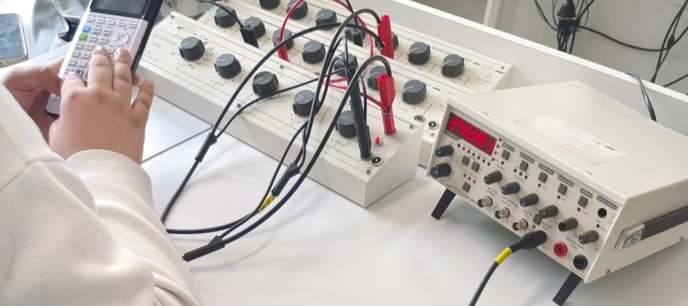
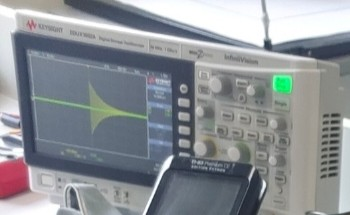
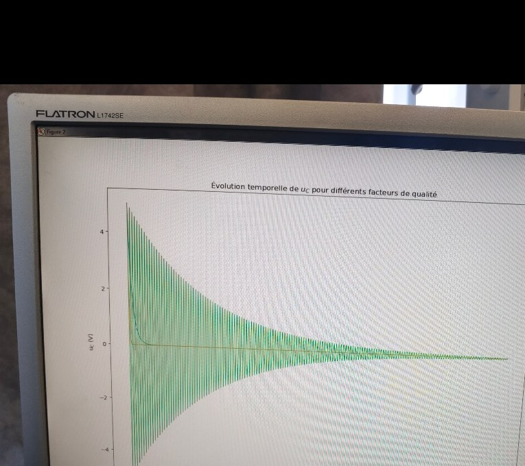

# Résonance d'un circuit RLC série : du banc de TP à la simulation

🇫🇷 [Français](#français) · 🇬🇧 [English](#english)

**Essayer la démo :** https://valentin-auger-laboratoire.github.io/portfolio/demos/rlc/

---

## Français

### Le TP
TP de physique, **CPGE TSI, mars 2024**, monté et mesuré seul. Un générateur alimente une résistance, une bobine et un condensateur en série. L'oscilloscope affiche la tension du générateur (voie 1) et celle du condensateur u_C (voie 2).

| Le banc | L'oscilloscope pendant le TP |
|---|---|
|  |  |

Valeurs du montage :
- inductance L = 0,1 H, capacité C = 100 nF, soit f₀ = 1/(2π√(LC)) ≈ 1 592 Hz ;
- résistance R = 100 Ω ou 10 kΩ, plus les 50 Ω internes du générateur ;
- facteur de qualité Q = √(L/C) / R_total ≈ 6,67 avec 100 Ω, ≈ 0,1 avec 10 kΩ.

Ce qu'il fallait montrer :
- **f ≪ f₀ :** u_C suit le générateur (même amplitude, en phase) ;
- **f ≫ f₀ :** u_C devient minuscule et passe en opposition de phase ;
- **résonance en intensité :** elle se produit toujours à f₀ ;
- **résonance en tension :** elle n'existe que si Q > 1/√2. Elle est donc présente avec R = 100 Ω et disparaît avec R = 10 kΩ.

Sur la photo, le générateur affiche **24,88** : c'est un signal carré à basse fréquence. À chaque front, le circuit oscille puis s'amortit, et c'est ce que montre l'oscilloscope. La démo reproduit cet écran.

Le sujet et sa correction ne sont **pas** publiés : tout ce dépôt est recalculé à partir des lois du circuit.

### Le script Python
En mars 2024, j'avais tracé l'évolution temporelle de u_C pour plusieurs facteurs de qualité (Q = 0,1 ; 0,5 ; 100) :



**Le script d'origine est perdu.** Il est **recréé en 2026** dans `python/`, avec les valeurs du montage du TP :
- `regime_libre.py` : décharge du condensateur. L'équation du circuit est résolue par Runge-Kutta d'ordre 4 puis comparée à la solution exacte (écart inférieur à 10⁻⁷ V) → `images/regime-libre-2026.png`.
- `resonance.py` : courbes de résonance (U_C, intensité, déphasage) et valeurs du TP (f₀, Q, bande passante) → `images/resonance-2026.png`.

```bash
cd python
python regime_libre.py
python resonance.py
```

### La démo web (`demo/`)
- **Oscilloscope virtuel :**
  - voie 1 = sortie du générateur, qui baisse un peu à la résonance à cause de ses 50 Ω ;
  - voie 2 = u_C ;
  - calibres choisis automatiquement dans la suite 1-2-5 ;
  - signal sinusoïdal ou carré.
- **Cinq expériences :** 10 Hz, 100 kHz, à la résonance, R = 10 kΩ, et le carré à 24,88 Hz de ma photo.
- **Courbes de résonance :** u_C, intensité avec sa bande passante Δω = ω₀/Q, et déphasage, pour une famille de facteurs de qualité et pour le circuit réglé. Un clic sur une courbe change la fréquence.
- **Régime libre :** Q = 0,1, 0,5 et 100, plus le circuit réglé.
- **Tests :** `node demo/tests/test.js`, 266 tests.
  - Formules complexes = formules réduites.
  - Résonance en tension en x = √(1 − 1/2Q²), et seulement si Q > 1/√2.
  - Résonance en intensité en x = 1, bande passante 1/Q.
  - Runge-Kutta = solutions exactes (régimes pseudo-périodique, critique, apériodique).
  - Pseudo-période et enveloppe.
  - Sinus forcé simulé = formule.
  - Signal carré : régime périodique, dépassement E + 2E·e^(−απ/ω_d).

Hypothèses : composants idéaux (la résistance de la bobine est réglable, nulle par défaut comme dans le TP) et sonde d'oscilloscope parfaite.

---

## English

### The lab
Physics lab, **CPGE TSI, March 2024**, built and measured on my own: a signal generator drives a resistor, an inductor and a capacitor in series.
- **Values:** L = 0.1 H, C = 100 nF (f₀ ≈ 1,592 Hz), R = 100 Ω or 10 kΩ, plus the generator's 50 Ω.
- **Quality factor:** Q ≈ 6.67 or 0.1.
- **Expected results:** u_C follows the generator well below f₀ and becomes tiny and in phase opposition well above. There is always current resonance at f₀, but voltage resonance only if Q > 1/√2.
- **The photo:** the generator shows a 24.88 Hz square wave; the circuit rings after each edge, which the demo reproduces.
- **Not published:** the lab sheet and its answers. Everything here is recomputed from the circuit laws.

### Python
My original March 2024 script (u_C(t) for Q = 0.1, 0.5, 100) is lost. It is **recreated in 2026** in `python/`, with RK4 checked against the exact solution, plus the resonance curves.

### Web demo (`demo/`)
- Virtual oscilloscope, sine or square wave.
- Five experiments: 10 Hz, 100 kHz, resonance, R = 10 kΩ, and the 24.88 Hz square wave from my photo.
- Resonance curves with bandwidth; free response.
- 266 tests.

---

← [Portfolio](https://valentin-auger-laboratoire.github.io/portfolio/#projets)
